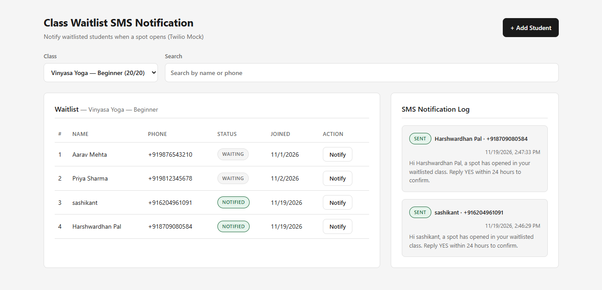
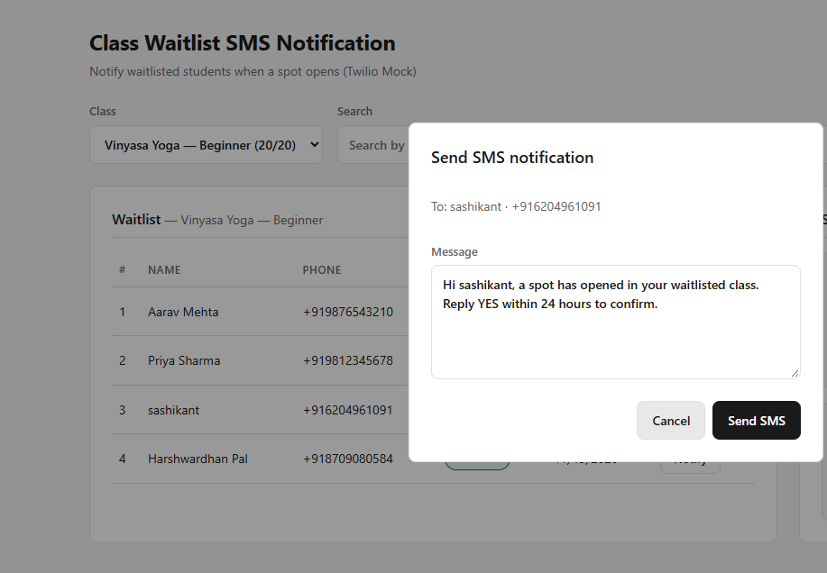
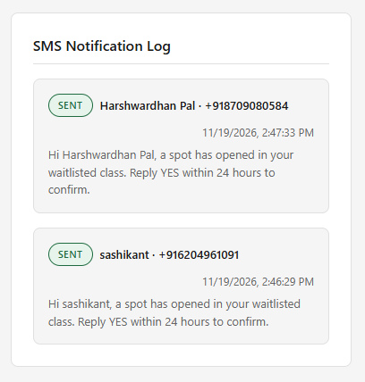

# 🚀 Class Waitlist SMS Notification System

### Smart Class Waitlist Management & Automated SMS Notifications

<p align="center">
  
  
  
  
</p>

<p align="center">
  A modern React + TypeScript application for managing class waitlists and sending automated SMS notifications when a spot becomes available.
</p>

<p align="center">
  <a href="YOUR_LIVE_DEMO_URL">🌐 Live Demo</a> •
  <a href="https://github.com/y-ro9/waitlist-smsL">📂 GitHub Repository</a>
</p>

---

## 📌 Overview

**Class Waitlist SMS Notification System** is a modern, responsive application designed for studio and class floor staff to efficiently manage student waitlists and notify students when a class spot becomes available.

The application features a mocked Twilio SMS integration, asynchronous operations, localStorage persistence, and automated testing.

Built with React 18, TypeScript, and Vite, this project demonstrates real-world frontend development practices without requiring a backend server.

---

## ✨ Key Features

- 📋 **Class Management** – View and manage available classes and enrollment details.
- 👥 **Waitlist Management** – Add students to waitlists with automatically assigned positions.
- 📱 **SMS Notifications** – Notify students when a class spot becomes available.
- 🔔 **Mock Twilio Integration** – Simulate SMS delivery with deterministic success and failure responses.
- 📊 **SMS Activity Logs** – Track notification history and delivery statuses.
- 💾 **Local Storage Persistence** – Save application data directly in the browser.
- 🔍 **Input Validation** – Validate user inputs with inline error messages.
- 🛡️ **XSS Protection** – Sanitize text inputs before persistence.
- ⚡ **Async Operations** – Simulate realistic network delays.
- ♿ **Accessibility** – Keyboard navigation and accessible UI components.
- 🧪 **Automated Testing** – Test components and application behavior using Vitest and React Testing Library.

---

## 🛠️ Tech Stack

| Technology | Purpose |
|---|---|
| React 18 | Frontend UI |
| TypeScript | Static Type Checking |
| Vite | Development & Build Tool |
| Vitest | Unit Testing |
| React Testing Library | Component Testing |
| localStorage | Mock Database |
| Mock Twilio | SMS Simulation |

---

## 🌐 Live Demo

🚀 **Try the Application:** [Live Demo](YOUR_LIVE_DEMO_URL)

📂 **Source Code:** [GitHub Repository](https://github.com/y-ro9/waitlist-sms)

---

## 📸 Screenshots





---

## 🚀 Getting Started

Follow these steps to run the project locally.

### 1. Clone the Repository

```bash
git clone https://github.com/y-ro9/waitlist-sms.git
```

### 2. Navigate to Project Directory

```bash
cd waitlist-sms
```

### 3. Install Dependencies

```bash
npm install
```

### 4. Start Development Server

```bash
npm run dev
```

Open your browser:

```text
http://localhost:5173
```

---

## 📜 Available Scripts

| Command | Description |
|---|---|
| `npm run dev` | Start development server |
| `npm test` | Run automated tests |
| `npm run lint` | Run ESLint checks |
| `npm run build` | Create production build |

---

## 🔄 Application Workflow

1. **Select a Class** – View available classes and enrollment information.
2. **Add a Student** – Enter student details to join a waitlist.
3. **Assign Position** – Automatically assign the next waitlist position.
4. **Open a Spot** – Initiate an SMS notification when a seat becomes available.
5. **Send Notification** – Simulate SMS delivery through the mocked Twilio service.
6. **Track Activity** – View notification history and delivery status in SMS logs.

---

## 🧪 Edge Cases & Error Handling

| Scenario | Handling |
|---|---|
| Empty Data | Displays helpful empty-state messages |
| Search Miss | Shows `No data found` message |
| Slow Connection | Displays loading spinner using `role="status"` |
| Invalid Input | Highlights fields with inline errors |
| XSS Protection | Sanitizes text inputs before persistence |
| SMS Failure | Numbers ending in `0000` trigger deterministic failure |
| Unknown Class | Returns an empty waitlist |
| Missing Student | Returns notification error |

---

## ♿ Accessibility

Accessibility is considered throughout the application.

- Keyboard-accessible interactive elements.
- Accessible dialogs using `role="dialog"` and `aria-modal`.
- Escape key support for closing modals.
- Autofocus on the first form field.
- `aria-invalid` and `aria-describedby` for validation errors.
- Screen-reader-friendly loading indicators.

**Accessibility Goal:** 100% Lighthouse accessibility score.

---

## 📊 Analytics

Primary user interactions are logged to the browser console.

Example:

```text
[Analytics] User interacted with Class Waitlist SMS Notification Job (Twilio Mock) — <action>
```

---

## 🗄️ Database Schema (ERD)

The application uses a relational-style data model persisted through localStorage.

```text
┌──────────────────┐       ┌──────────────────┐
│     Student      │       │    ClassInfo     │
├──────────────────┤       ├──────────────────┤
│ id (PK)          │       │ id (PK)          │
│ name             │       │ name             │
│ phone            │       │ capacity         │
│ email            │       │ enrolled         │
└────────┬─────────┘       │ schedule         │
         │                 └────────┬─────────┘
         │                          │
         └──────────┬───────────────┘
                    │
                    ▼
          ┌──────────────────────┐
          │    WaitlistEntry     │
          ├──────────────────────┤
          │ id (PK)              │
          │ studentId (FK)       │
          │ classId (FK)         │
          │ position             │
          │ joinedAt             │
          │ status               │
          │ notifiedAt           │
          └──────────┬───────────┘
                     │
                     ▼
          ┌──────────────────────┐
          │       SmsLog         │
          ├──────────────────────┤
          │ id (PK)              │
          │ waitlistEntryId (FK) │
          │ phone                │
          │ message              │
          │ status               │
          │ sentAt               │
          └──────────────────────┘
```

### Entity Relationships

- One Student can have multiple waitlist entries.
- One ClassInfo can have multiple waitlist entries.
- One WaitlistEntry can have multiple SMS log records.

---

## 🔌 API Contracts

All operations are asynchronous and return Promises.

A deliberate **150–600 ms simulated latency** recreates the experience of network requests and Twilio communication.

| Method | Endpoint | Description |
|---|---|---|
| GET | `/api/classes` | Retrieve all classes |
| GET | `/api/classes/:id/waitlist` | Retrieve a class waitlist |
| POST | `/api/classes/:id/waitlist` | Add a student to a waitlist |
| POST | `/api/waitlist/:entryId/notify` | Send an SMS notification |
| GET | `/api/classes/:id/sms-log` | Retrieve SMS activity logs |

### Add Student Request

```json
{
  "name": "John Doe",
  "phone": "9876543210",
  "email": "john@example.com"
}
```

### SMS Notification Request

```json
{
  "message": "A spot is now available in your class!"
}
```

### Type Definitions

See:

- `src/types.ts`
- `src/services/api.ts`

---

## 📁 Project Structure

```text
waitlist-sms/
│
├── src/
│   ├── components/
│   ├── services/
│   ├── types.ts
│   └── ...
│
├── public/
├── package.json
├── vite.config.ts
├── tsconfig.json
└── README.md
```

*Note: Update the structure according to your actual project files.*

---

## ⚠️ Important Notes

- This project uses a mocked Twilio service.
- No real SMS messages are sent.
- No actual Twilio credentials are required.
- localStorage is used instead of a production database.
- API contracts simulate backend operations within the application.

---

## 👨‍💻 Author

**YASH RAJ**

Frontend Developer | React.js | TypeScript | JavaScript

- GitHub: [y-ro9](https://github.com/y-ro9)
- LinkedIn: [Yash Raj](https://www.linkedin.com/in/yash-raj-ba4414312)
- Portfolio: [Portfolio](https://y-ro9.github.io/resume-portfolio/)
- Email: yr662003@gmail.com

---

## ⭐ Support

If you find this project useful or interesting:

- ⭐ Star this repository.
- 🍴 Fork the project.
- 🐛 Report bugs or suggest improvements.
- 📢 Share it with other developers.

---

<p align="center">
  Made with ❤️ using React, TypeScript & Vite.
</p>

<p align="center">
  <b>Thanks for visiting! Happy Coding 🚀</b>
</p>
